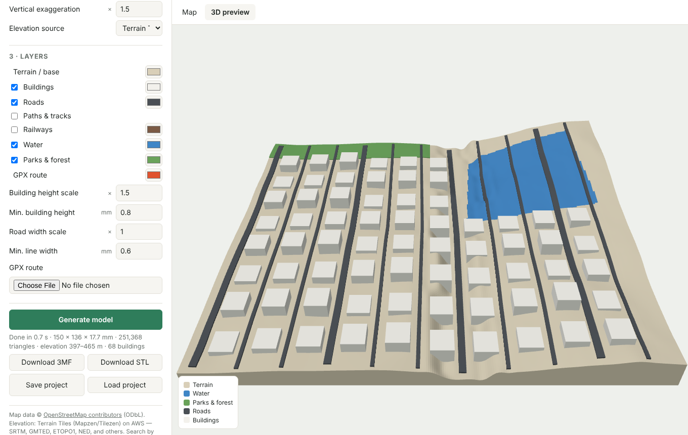

# TopoForge

Turn any place on Earth into a 3D-printable model, right in the browser.
Draw a rectangle on the map, generate, and download a **multicolor 3MF**
(one part per feature type) or a single **STL**. No account and no backend:
the browser fetches all data from free public services and builds the mesh
locally.



## Features

- Search (Nominatim), draw a rectangle, or use the current map view.
  Deep link: `?area=west,south,east,north`.
- Real terrain from free elevation tiles (AWS Terrain Tiles or Mapterhorn),
  with vertical exaggeration.
- OpenStreetMap layers: buildings (height from `height` / `building:levels`),
  roads, paths, railways, water (lakes, rivers) and parks/forest.
- GPX route embossed as its own part.
- Per-layer colours. The 3MF contains one object per part, grouped as one
  model, so Bambu Studio / OrcaSlicer / PrusaSlicer let you assign a filament
  per part.
- Print-oriented settings: model width, base thickness, detail (cell size),
  building height scale, minimum building height and minimum line width.
- Save / load projects as JSON.

## Free data sources

| Data | Service | Licence / terms |
|---|---|---|
| Base map | `tile.openstreetmap.org` | [OSM tile usage policy](https://operations.osmfoundation.org/policies/tiles/) |
| Features | Public Overpass API (`overpass-api.de`, with fallbacks) | ODbL, © OpenStreetMap contributors |
| Search | Nominatim | [Usage policy](https://operations.osmfoundation.org/policies/nominatim/): max 1 req/s, search on submit only |
| Elevation | [Terrain Tiles on AWS](https://registry.opendata.aws/terrain-tiles/) (Mapzen/Tilezen), or [Mapterhorn](https://mapterhorn.com) | Attribution required (shown in the app and written into 3MF metadata) |

To stay friendly to these shared services, the app sends one Overpass query
per generation and only loads map layers for areas up to 10 km per side.
Larger areas, up to 400 km per side, produce terrain only. If you deploy this
for heavy traffic, run your own tile and Overpass servers.

## How the model is built

- **Terrain, water, greenery**: an elevation grid of cells (default 0.6 mm).
  Each cell belongs to one class. Each class becomes its own closed solid, so
  the colour parts tile the base with no overlaps.
- **Buildings**: footprints are triangulated with earcut and extruded. They
  sit on the lowest terrain point under the footprint and are sunk slightly
  into the ground.
- **Roads, rails, rivers, GPX**: ribbons draped over the terrain. They are
  split at sharp turns and plugged with small joints. Every width is clamped
  to a printable minimum.
- All solids are closed and consistently oriented; unit tests check this.

## Develop

```bash
npm install
npm run dev        # http://localhost:5173
npm test           # unit tests (geometry, parsers, exporters)
npm run build      # static site in dist/ (host anywhere, e.g. GitHub Pages)
npm run e2e        # browser smoke test (needs Playwright + Chromium)
```

Code map: `src/data` (Overpass, elevation, Nominatim, GPX), `src/geo`
(projection, clipping), `src/mesh` (solids), `src/export` (STL, 3MF),
`src/main.js` (UI), `src/preview.js` (three.js preview).
